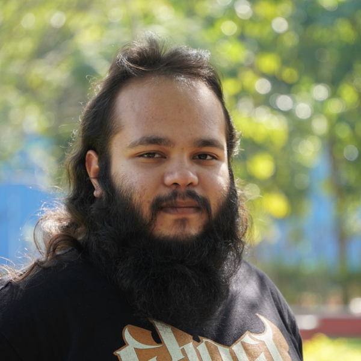

I am a research scholar in the Astrophysics and Relativity group at the [International Centre for Theoretical Sciences](https://icts.res.in/) (ICTS), Tata Institute of Fundamental Research. I am working towards my Ph.D. with [Prof. Pallavi Bhat](https://www.icts.res.in/people/pallavi-bhat), focusing on fluid and plasma processes in astrophysical settings.

My current work is broadly concerned with the dynamics of magnetic fields in astrophysical plasmas. I study magnetic reconnection, magnetohydrodynamic turbulence, dynamos, and the links between these processes using high-resolution numerical simulations supported by physical insight and analytical calculations.

For research details, see the [Research](/research/) page. Publications are listed on [Publications](/publications/), and a short background is on the [Bio](/bio/) page.

- Email (institute): [vinay.kumar@icts.res.in](mailto:vinay.kumar@icts.res.in)
- Email (personal): [the21vk@gmail.com](mailto:the21vk@gmail.com)
- ORCID: [0009-0008-2158-3774](https://orcid.org/0009-0008-2158-3774)
- CV: [PDF](/assets/docs/Vinay_Kumar_CV.pdf)
